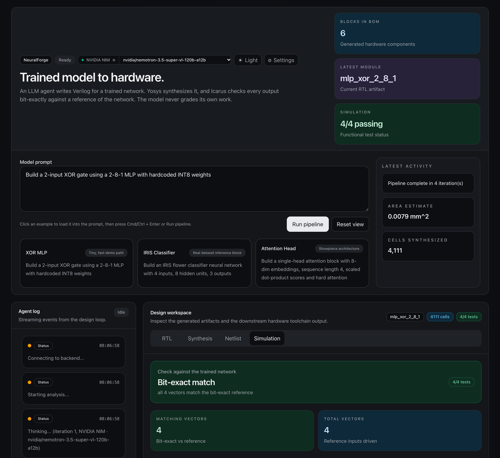

# NeuralForge

[](https://github.com/jishnuvenugopal/neuralforge/actions/workflows/tests.yml)

An LLM agent turns a plain-English request for a small neural network into
Verilog with the trained INT8 weights baked in. Yosys synthesizes it to
SkyWater 130 nm cells, and Icarus Verilog checks every output bit-exactly
against an integer reference of the network. The model writes the design;
it never writes or grades the test.

Pipeline: request → hardware bill of materials → RTL → synthesis gate →
reference simulation → optional LibreLane hardening to GDS.

![NeuralForge in one picture: a plain-English request goes to the model, which writes a hardware BOM and Verilog with the trained weights baked in. Gate 1, Yosys synthesis to SkyWater 130 nm cells, rejects empty, constant or latched designs and records the code's sha256. Gate 2 runs a NeuralForge-written testbench in Icarus and requires every output to match bit-exactly. A failing gate sends its error back to the model, for at most 15 model turns. The XOR MLP, Iris classifier and attention-head presets have bit-exact references; any other request is reported as not verified.](docs/images/overview.svg)



*A real run, not the mock replay: the XOR MLP preset on
`nvidia/nemotron-3.5-super-vl-120b-a12b` (NVIDIA NIM), 16 November 2026.
4/4 outputs match the integer reference bit-exactly; 4,111 SkyWater 130 cells,
30,063.8 µm² (full ABC mapping), 4 agent iterations, 306 s from Run to complete. The "Area estimate"
tile is the model's own pre-synthesis guess. The RTL, its sha256 and the verdict
are saved in [`docs/runs/2026-11-16_xor_super-vl/`](docs/runs/2026-11-16_xor_super-vl/);
re-check them with `python3.12 docs/runs/recheck.py docs/runs/2026-11-16_xor_super-vl`.
Synthesis panel of the same run: [`docs/images/synthesis_xor_2026-11-16.png`](docs/images/synthesis_xor_2026-11-16.png).*

## Quick start

```bash
git clone https://github.com/jishnuvenugopal/neuralforge.git
cd neuralforge
bash setup.sh      # once: Python packages, UI build, checks Yosys / Icarus
bash start.sh      # serves everything at http://localhost:8000
```

The app opens in your browser. It always starts in dark mode; the header has a
light-mode switch for the current visit. On first launch the **Settings** drawer opens by itself:

- **Model provider:** paste an API key and press *Save and test*. Keys are
  stored only on your machine in `.neuralforge/settings.json` (git-ignored, mode 600).
- **Setup guide:** shows which tools are installed and the command for anything missing.

`bash start.sh --dev` runs the UI with hot reload on port 5173.

### Model providers

| Provider | Wire protocol | Model | Notes |
|---|---|---|---|
| **NVIDIA NIM** (default) | OpenAI-compatible | `nvidia/nemotron-3.5-super-vl-120b-a12b` by default; Nemotron, GLM, GPT-OSS and more | Base URL `https://integrate.api.nvidia.com/v1`; free key at [build.nvidia.com](https://build.nvidia.com) |
| OpenAI-compatible | `/v1/chat/completions` with tools | any | OpenAI, a gateway or a local server: your base URL, key and model |
| Anthropic-compatible | Messages API with tool use | any (default `claude-opus-5-5`) | Your base URL, key and model |

Pick the model from the dropdown in the header or in Settings. *Load models*
asks the provider's `/models` endpoint for its current list.

Settings is the usual way to set these. Environment variables also work, which
suits headless runs and CI; values saved in Settings win over them.
`NEURALFORGE_PROVIDER` picks the provider (default `nvidia_nim`), then each
provider reads its own key, base URL and model:

```bash
# NVIDIA NIM (default provider)
export NVIDIA_API_KEY="nvapi-..."
export NVIDIA_NIM_MODEL="nvidia/nemotron-3.5-super-vl-120b-a12b"

# Any OpenAI-compatible endpoint
export NEURALFORGE_PROVIDER=openai_compatible
export OPENAI_API_KEY="..."
export OPENAI_BASE_URL="https://api.openai.com/v1"   # or your gateway / local server
export OPENAI_MODEL="your-model-id"

# Any Anthropic-compatible endpoint
export NEURALFORGE_PROVIDER=anthropic_compatible
export ANTHROPIC_API_KEY="..."
export ANTHROPIC_BASE_URL="https://api.anthropic.com"
export ANTHROPIC_MODEL="claude-opus-5-5"

export LIBRELANE_AUTO_HARDEN=1   # optional: run LibreLane after a verified simulation
```

<details>
<summary>Other variables the code reads</summary>

| Variable | Default | Sets |
|---|---|---|
| `NVIDIA_NIM_BASE_URL` | `https://integrate.api.nvidia.com/v1` | NIM base URL (not editable in Settings) |
| `NEURALFORGE_PORT` | `8000` | server port |
| `NEURALFORGE_NO_BROWSER` | unset | `1` stops `start.sh` opening a browser |
| `NEURALFORGE_HOME` | `.neuralforge/` | folder for saved settings and keys |
| `NEURALFORGE_SYNTH_TIMEOUT_SEC` | `90` | full ABC mapping, before the `abc -fast` retry |
| `NEURALFORGE_SYNTH_FAST_TIMEOUT_SEC` | `300` | the `abc -fast` retry |
| `NEURALFORGE_SIM_TIMEOUT_SEC` | `30` | Icarus simulation |
| `LIBRELANE_ROOT` | `../librelane` | LibreLane checkout (uses its `shell.nix`) |
| `LIBRELANE_PDK_ROOT` | `~/.ciel` | PDK folder for LibreLane |
| `LIBRELANE_TIMEOUT_SEC` | `1800` | hardening time limit |
| `LIBRELANE_DEFAULT_CLOCK_PERIOD_NS` | `10` | clock period for hardening |
| `LIBRELANE_DEFAULT_DIE_AREA` | `[0, 0, 600, 600]` | die area for hardening (JSON list) |
| `NIX_PROFILE_BIN` | `/nix/var/nix/profiles/default/bin` | where to look for Nix tools |

</details>

### Requirements

Python 3.10+, Node.js (once, to build the UI), Yosys and Icarus Verilog
(`brew install yosys icarus-verilog`, or `sudo apt install yosys iverilog`).
`netlistsvg` and Nix + LibreLane are optional. The Setup guide in the app checks all of these.

## How it works

The model only ever proposes code. Each proposal goes through two gates that
NeuralForge owns, and a failure goes back to the model as an error message,
for at most 15 model turns. The sha256 recorded at synthesis follows the code
through simulation and, if enabled, hardening, so every verdict belongs to one
exact design.

![One run, step by step: 1, the request arrives over the WebSocket. 2, a preset is matched and its INT8 weights, test vectors and integer reference are loaded; constants and a port contract are added to the prompt, and an unmatched request ends not verified. 3, a model turn. 4, analyze_model returns a hardware BOM. 5, synthesize_verilog runs the synthesis gate: source scan, Yosys mapping to SkyWater 130 nm with abc -fast after 90 s, netlist checks, and the code's sha256 into the ledger. 6, simulate_verilog runs the reference gate: only the hashed code, a NeuralForge testbench, a nonce-stamped result file and a comparison of every output. 7, verified. A failure in step 5 or 6 returns to step 3. LibreLane hardening to GDS is optional.](docs/images/run_flow.svg)

## Presets

Each preset has a bit-exact reference, so every run is checked, not just synthesized:

| Preset | Network | Test vectors |
|---|---|---|
| XOR MLP | 2-8-1 MLP, ReLU, INT8 weights, 32-bit accumulators | all 4 inputs |
| Iris classifier | 4-8-3 MLP trained on Iris | all 150 samples (integer net: 148/150 correct) |
| Attention head | d = 8, 4 tokens, Q/K/V projections, scaled scores, hard attention | 67 token sets (3 edge cases + 64 seeded) |

The attention spec is NeuralForge's own exact integer definition (softmax is
replaced by hard attention, so the result is bit-exact):
`P = (W·x) >>> 8` for Q, K and V; `S = (Q·Kᵀ) >>> 3`; each query takes the V
row of its highest-scoring key (lowest index on ties). See `AttentionReference`
in `backend/golden.py`.

A free-form request that matches no preset is synthesized but reported as
**not verified**, and is never hardened.

## Results

Live runs driven through the same WebSocket the dashboard uses. A run passes
when every output the design produces equals the integer reference. That is the
gate's score, not classification accuracy. Every row names the provider and model
that produced it.

| Date | Provider · model | Preset | Outputs matching the reference | Cells | Agent iterations | Wall time | Re-checkable |
|---|---|---|---|---|---|---|---|
| 2026-10-20 | NVIDIA NIM · `nvidia/nemotron-3.5-super-vl-120b-a12b` | XOR MLP | 4/4 | 3,978 | 4 | 169 s | no |
| 2026-10-19/20 | NVIDIA NIM · `nvidia/nemotron-3.5-super-vl-120b-a12b` | Iris classifier | 150/150 | 21,120 | 3 | 647 s | no |
| 2026-10-19/20 | NVIDIA NIM · `nvidia/nemotron-3.5-super-vl-120b-a12b` | Attention head | 67/67 | 491,948 | 3 | 1,316 s | no |
| 2026-11-16 | NVIDIA NIM · `nvidia/nemotron-3.5-super-vl-120b-a12b` | XOR MLP | 4/4 | 4,111 | 4 | 306 s | [yes](docs/runs/2026-11-16_xor_super-vl/) |

**How the model is recorded.** The backend snapshots the provider and model when
a run starts and sends them in the run's first WebSocket message (`run_info`) and
its last (`complete`). The dashboard shows them as a badge in the Design workspace,
and a saved run keeps them as `provider` and `model` in its `run.json`. Keys, key
hints and base URLs are never part of a run record.

What these numbers do and do not show:

- **One passing run per preset, on one model.** The pass rate over repeated
  runs has not been measured. An earlier attention attempt failed its first
  synthesis and was cut off after 1,740 s while fixing it; earlier Iris
  attempts were cut off by the test driver's 540 s limit.
- **Another model failed.** `openai/gpt-oss-20b` failed the attention preset:
  two submissions with Verilog syntax errors, a garbled tool name, and no
  synthesis passed before the 2,700 s limit. It was the fastest model on a
  simple tool-calling probe, so probe speed did not predict preset results.
- **Cell counts are approximate.** The runs did not record whether full or
  `abc -fast` mapping produced them, and fast mapping overstates area.
- **The October runs cannot be re-checked.** Their generated RTL and raw outputs
  were not kept. One later run can be: the XOR run from 16 November 2026 shown
  at the top (4/4, 4,111 cells, 306 s) is saved with its RTL and sha256 in
  [`docs/runs/2026-11-16_xor_super-vl/`](docs/runs/2026-11-16_xor_super-vl/), and
  `python3.12 docs/runs/recheck.py docs/runs/2026-11-16_xor_super-vl` re-runs
  synthesis and the reference simulation on it. The October record, including
  a tool-calling probe of eight NIM models, is in
  [`koder/issues/001_nim_provider_testing/INDEX.md`](koder/issues/001_nim_provider_testing/INDEX.md).
- **Wall time is mostly provider latency.** Model turns took 200–650 s each
  on those days.

## Limitations

- Only the three presets are verified. Free-form requests are synthesized
  and reported as not verified.
- The networks are small and fixed: 2-8-1 and 4-8-3 MLPs, and one attention
  head with d = 8 and 4 tokens.
- Attention uses hard attention instead of softmax, so the reference can be
  exact integer arithmetic.
- LibreLane hardening is optional and needs Nix; the results above cover
  synthesis and simulation only.

## Architecture

NeuralForge is one local Python process. The browser talks to it over a
WebSocket for runs and REST for settings; the server reaches the model provider
over HTTPS and runs the EDA tools as subprocesses.

![Architecture: the React and Vite dashboard in the browser talks to a FastAPI server on localhost:8000 over the WebSocket /ws/design and REST endpoints under /api. Inside the server: settings.py and prereqs.py, llm.py, the agent loop with its four tools, and the verification gate made of golden.py, verifier.py and eda_tools.py. llm.py calls the model provider over HTTPS: NVIDIA NIM by default, or any OpenAI- or Anthropic-compatible API. eda_tools.py runs Yosys with pdk/sky130.lib and Icarus Verilog, and optionally netlistsvg and LibreLane via Nix. model_trainer.py and docs/runs/recheck.py run offline.](docs/images/architecture.svg)

### Project layout

```text
neuralforge/
├── backend/
│   ├── main.py          agent loop, REST + WebSocket API, serves the UI
│   ├── llm.py           OpenAI- and Anthropic-compatible tool-calling conversation
│   ├── settings.py      provider settings (local file, keys never returned to the browser)
│   ├── prereqs.py       machine checks for the Setup guide
│   ├── eda_tools.py     Yosys / Icarus / LibreLane wrappers
│   ├── golden.py        bit-exact integer references (XOR, Iris, attention)
│   ├── verifier.py      source scan, generated testbench, verdict, hash ledger
│   └── model_trainer.py trains and quantizes the demo models
├── docs/                README images and saved runs (docs/runs/recheck.py re-verifies one)
├── frontend/            React + Vite UI (built into frontend/dist)
├── pdk/                 SkyWater 130 nm liberty (Apache-2.0, see pdk/NOTICE)
├── koder/               development notes: session hand-off and issue records
├── tests/
├── setup.sh
└── start.sh
```

## How a design is verified

![Who controls the verdict. The model writes a hardware BOM, Verilog with the INT8 weights baked in, its own area estimate and the name of the module to simulate; it never writes a testbench, an expected value or the verdict. NeuralForge writes the weights and test vectors, the integer reference, the port contract, the testbench and nonce-stamped result file, the comparison and the sha256 ledger. Four exploits against the first version and what closes each: a design that prints the pass line, closed by scoring only the nonce-stamped result file; a model-written testbench, closed by NeuralForge writing it from the reference; outputs tied to a constant, closed by netlist checks; swapped code, closed by binding each step to the code's sha256.](docs/images/trust_boundary.svg)

The first version of NeuralForge trusted two things it should not have: text
the design could print, and a testbench written by the same model that wrote
the design. I attacked that gate and found four ways to pass it with a wrong
design:

1. **A design that prints the pass line.** The verdict was a regex over the
   simulator's output, so a design with `$display("4/4 TESTS PASSED")` passed.
2. **A testbench that never checks.** The model wrote both the design and the
   testbench, and the expected values came from the model.
3. **A constant design.** Synthesis only checked Yosys' exit code, so a design
   with its outputs tied to 0 passed with 0 cells and 0 µm².
4. **Swapped code.** Simulation took fresh code, so the design that was
   simulated (and then hardened) did not have to be the one that was synthesized.

The gate now works like this:

- **Expected outputs come from the reference, not the model.** `golden.py` runs
  each preset in exact integer arithmetic (for the MLPs: INT8 weights, 32-bit
  accumulators, biases rescaled to the accumulator scale). The model is given a
  fixed port contract and the exact arithmetic.
- **NeuralForge writes the testbench.** It drives every input (XOR: all 4;
  Iris: all 150 samples; attention: 67 token sets) and writes the raw outputs to a result file whose
  name and contents carry a per-run random nonce. Python compares every logit
  and class with the reference. What the simulator prints is shown, never scored.
- **The design cannot talk to the testbench.** Design code with system tasks
  (`$display`, `$fopen`, `$finish`, ...), `initial` blocks, `force`,
  hierarchical references or compiler directives other than `timescale` is
  rejected before synthesis.
- **Synthesis must produce real logic.** The design needs more than 0 cells, no
  latches, and no output that is constant or undriven.
- **Each verdict is tied to the exact code.** Synthesis records the sha256 of
  the code it passed; simulation runs only that code, and LibreLane only runs
  on code whose hash passed both.

The same work fixed the weight hand-off: every constant now has a unique name
(`W1_r_c`, `B1_r`, ...; before, bias names collided with weight column 0), and
biases are given at the scale they are added at. Each run uses its own temporary
folder, and the flip-flop count includes flops with reset.

The exploits are regression tests. Run them with Yosys and Icarus installed,
using the interpreter `setup.sh` reported as `Python: …` (it takes the first
of `python3.12`, `python3.13`, `python3.11` and `python3` it finds):

```bash
python3.12 -m unittest discover -s tests -v
```

The simulator tests skip themselves when the tools are missing. CI
(`.github/workflows/tests.yml`) runs the suite on Ubuntu 24.04 with apt's
Yosys and Icarus on every push and pull request, and fails if any test is
skipped, so a green badge means the gate itself was tested.

## Notes

- **Synthesis time.** Area comes from full ABC mapping. A fully parallel design
  can take minutes to map (the 32-bit Iris network does), so after 90 s the gate
  retries with `abc -fast` and labels the stats `abc_mode: fast`. Fast mapping
  overstates area (77 % larger on XOR).
- `?mock=true` replays a canned run without calling any model.

## License

MIT, except `pdk/`. `pdk/sky130.lib` comes from the SkyWater SKY130 PDK and
is under the Apache License 2.0; see `pdk/NOTICE` and `pdk/LICENSE`.
